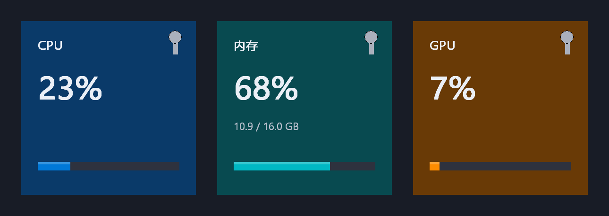
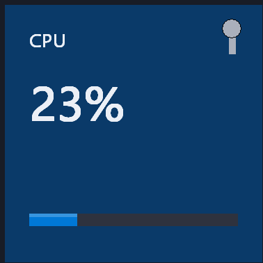

# SysMonitor · 桌面硬件监控贴片

三块可自由拖动的 Metro 风格桌面贴片，实时显示 **CPU / 内存 / GPU** 占用。
纯原生 Win32 + C 实现，**零运行时依赖**，单个程序仅 71 KB。

  

## 截图

三块贴片（示例图使用纯色背景绘制，未包含任何桌面壁纸）：



单块贴片细节（右上角为图钉按钮）：



---

## 特性

| | |
|---|---|
| **三块独立贴片** | CPU / 内存 / GPU 各自是独立窗口，可单独拖到桌面任意位置，位置自动记住 |
| **半透明玻璃** | 逐像素 Alpha，壁纸透出来，不遮挡背景 |
| **图钉按钮（v1.3）** | 每块右上角独立图钉：点击置顶 / 沉底，点 CPU 只影响 CPU，互不影响 |
| **关键设置（v1.3）** | 设置页可切换**边角样式（直角/圆角）**、每个指标独立的**显示开关**与**颜色**，保存后立即生效并持久化 |
| **不抢焦点** | 默认待在桌面层，开着别的软件不会跳出来挡路；需要时可用图钉钉到最前 |
| **原生拖动** | 走 `HTCAPTION` 系统级拖动，稳、不会飞出屏幕边界 |
| **数据对齐任务管理器** | 与「性能」页同源同口径：CPU 用 `GetSystemTimes`，内存用 total−available，GPU 用 Windows GPU Engine 计数器 |
| **开机自启** | 写入 `HKCU\...\Run`，任务管理器 → 启动 里可见，可一键开关（含路径校验，避免换目录后失效） |
| **可调设置** | 刷新间隔（1/2/5 秒）、透明度四档（含 0 = 无背景）、边角样式、每指标显示/颜色、开机自启；改完立即生效 |
| **高 DPI 适配** | Per-Monitor DPI V2 + `AdjustWindowRectExForDpi`，设置窗在高缩放下不裁切 |
| **托盘常驻** | 托盘图标可唤出/退出，双击回到桌面 |
| **安装向导** | 可选安装盘符/目录，免管理员权限，装完建桌面+开始菜单快捷方式 |
| **体积/内存** | 程序 71 KB，运行内存约 29 MB；安装包 180 KB |

---

## 使用方法

### 安装

**下载即用**（二选一）：
- 直接下载最新版：[SysMonitor-Setup-v1.3.exe](https://github.com/a2109246162-tech/SysMonitor/raw/main/release/SysMonitor-Setup-v1.3.exe)（180 KB，免安装运行时依赖）
- 或进入仓库 [`release/`](https://github.com/a2109246162-tech/SysMonitor/tree/main/release) 目录下载
- 也可在 [Releases](https://github.com/a2109246162-tech/SysMonitor/releases) 页下载自动生成的源码包自行构建

双击运行：

1. **选择安装位置** —— 下拉框列出所有磁盘及可用空间，默认选「推荐位置（当前用户，无需管理员）」；也可切到其他盘符或点「浏览…」自选目录。
2. 点 **安装**，进度条走完即完成；勾选「立即启动」可直接运行。
3. 装完桌面会出现 **系统监控** 快捷方式。

> 默认装到 `%LOCALAPPDATA%\Programs\SysMonitor`，**不需要管理员权限**。
> 如果选了需要权限的盘符而写入被拒，安装器会提示是否改回推荐位置。

### 使用

| 操作 | 效果 |
|---|---|
| **左键拖动贴片** | 自由摆放；松手后位置自动记住，下次启动还在原处 |
| **点贴片右上角图钉** | 单独固定该贴片（置顶）/ 取消固定（沉底），只影响这一块 |
| **右键贴片 / 右键托盘图标** | 弹出菜单：固定到最前 / 开机自启 / 立即刷新 / 设置… / 关于… / 退出 |
| **设置…** | 刷新间隔、透明度（含 0）、边角样式（直角/圆角）、每指标显示开关与颜色、开机自启；**立即生效并保存** |
| **双击托盘图标** | 把三块贴片唤到前台 |

### 卸载

「设置 → 应用 → 已安装的应用 → 系统监控 → 卸载」，或直接运行安装目录下的 `unins.exe`。
卸载会一并清理：程序文件、桌面/开始菜单快捷方式、开机自启项、设置项。

---

## 实现方式

### 整体架构

```
SysMonitor.exe (单进程)
├── 控制窗 SysMonCtrl   隐藏(0×0)，负责：
│                        采样定时器 / 动画定时器 / 托盘图标 / 右键菜单 / 设置窗口 / 单实例
├── 贴片窗 ×3 SysMonTile  CPU / 内存 / GPU
│                        各自独立：DIB 画布 + 区域映射 + UpdateLayeredWindow
│                        各自可拖动，位置存 Pos0/Pos1/Pos2
└── 设置窗 SysMonSettings 纯 CreateWindowW 代码创建控件
```

### 1. 半透明玻璃（逐像素 Alpha）

窗口带 `WS_EX_LAYERED`，每块贴片自建一块 32bpp DIB 作画布：

```c
DrawTileScene(tc);        // GDI 画到 DIB：底色、强调条、文字、进度条
AlphaPass(tc);             // 逐像素改写 alpha 并做预乘
UpdateLayeredWindow(hwnd, NULL, &dst, &sz, tc->memDC, &src, 0, &bf, ULW_ALPHA);
```

`AlphaPass` 的规则：**底色像素**按底色查表赋半透明值，**文字/进度条**保持不透明，**圆角外**置 0。
为避免每帧逐像素判色带来的开销，启动时预生成一张 `region` 映射表（每字节标记该像素属于「圆角外 / 底色 / 其他」），运行时只查表 + 比较。

### 2. 高 DPI 缩放

本机 3840×2160 @250%，固定像素会导致界面极小。全程用 `MulDiv(v, dpi, 96)` 缩放：

```c
static int S(int v) { return MulDiv(v, g_dpi, 96); }
```

布局、字体高度、圆角半径、进度条宽度全部走 `S()`，一套代码在 100%–300% 缩放下都正常。

### 3. 原生拖动

自写 `SetCapture` + 鼠标增量做拖动有两个坑：鼠标移出屏幕边界时坐标计算溢出（实测窗口被推到 `x=-32768`）。最终改用系统原生方式：

```c
case WM_NCHITTEST:
    return HTCAPTION;      // 整块当标题栏，交给系统拖
case WM_EXITSIZEMOVE:
    SavePos(idx);          // 拖完记住位置
```

### 4. 数据采集（与任务管理器同口径）

| 指标 | 来源 | 口径 |
|---|---|---|
| CPU | `GetSystemTimes()` | 全系统所有核心合计，1 秒采样 |
| 内存 | `GlobalMemoryStatusEx()` | `(总物理 − 可用) / 总物理`，GB 同源计算 |
| GPU | PDH `\GPU Engine(*)\Utilization Percentage` | 与任务管理器同源；按 `luid+phys+eng+engtype` 分组跨进程求和后取最忙引擎 |

**GPU 采样的两个坑**（都踩过）：

1. 中文系统上英文计数器名要用 `PdhAddEnglishCounterA`，否则 `PdhAddCounterA` 直接加载失败 → GPU 恒为 0。
2. `PdhGetFormattedCounterArray` 返回的缓冲区是「**items 个定长结构体数组 + 紧随其后的字符串池**」，`szName` 指向字符串池，**不是**「结构体+名字」交替排列。按 `sizeof+strlen+1` 递推会读到野指针 → 访问违例崩溃。

### 5. 开机自启

写 `HKCU\Software\Microsoft\Windows\CurrentVersion\Run`，值为带引号的 exe 绝对路径 —— 任务管理器 → 启动 里可见。卸载时同步删除。

### 6. 设置窗口为什么不用 rc 资源

用 `.rc` 的 `DIALOGEX` 写中文，在 windres 下会因编码问题全部乱码。
改为**纯 `CreateWindowW` 代码创建控件**，所有中文以宽字符字面量直接写在 C 源码里 —— 从根上绕开编码问题。

---

## 从源码构建

### 依赖

- LLVM-MinGW 或 MinGW-w64 工具链（含 `clang`/`gcc`、`windres`）
- Python 3（仅用于生成 `app.ico`，可选）

### 构建

```bash
# Linux / Git Bash / MSYS2
bash build.sh

# 或手动
windres -I <toolchain>/include res/app.rc  -O coff -o app_res.o
windres -I <toolchain>/include res/unins.rc -O coff -o unins_res.o
windres -I <toolchain>/include res/setup.rc -O coff -o setup_res.o

clang --target=x86_64-w64-mingw32 -mwindows -O2 -s \
      -o SysMonitor.exe src/sysmon.c app_res.o \
      -lpdh -lmsimg32 -lkernel32 -luser32 -lgdi32 -lshell32 -ladvapi32

clang --target=x86_64-w64-mingw32 -mwindows -O2 -s \
      -o unins.exe src/unins.c unins_res.o \
      -ladvapi32 -lshell32 -lole32 -luser32 -lkernel32

clang --target=x86_64-w64-mingw32 -mwindows -O2 -s \
      -o SysMonitorSetup.exe src/setup.c setup_res.o \
      -lcomctl32 -lole32 -luuid -lshell32 -ladvapi32 -luser32 -lgdi32 -lkernel32
```

> `setup.rc` 通过 `RCDATA` 把 `SysMonitor.exe` 和 `unins.exe` 内嵌进安装包，因此**必须先编译出这两个文件**再编译安装程序。

### 目录结构

```
src/
  sysmon.c        主体：贴片 + 控制窗 + 设置窗
  setup.c         安装向导
  unins.c         卸载程序
res/
  app.rc          部件资源（图标 + manifest）
  setup.rc        安装包资源（图标 + manifest + 内嵌两个 exe）
  unins.rc        卸载程序资源
  app.ico         应用图标（由 gen_icon.py 生成）
  app.manifest    部件清单（高 DPI）
  setup.manifest  安装程序清单
  gen_icon.py     图标生成脚本
release/
  SysMonitor-Setup-v1.3.exe   预编译好的安装包
docs/
  screenshot.png  桌面效果截图
  tile-cpu.png    单块贴片截图
```

---

## 已知限制

- **仅 Windows 10 及以上**：GPU 引擎计数器（`\GPU Engine(*)`）自 Win10 才有；清单里声明了 Win10 支持。
- **不支持多显示器负坐标**：贴片位置以屏幕绝对坐标保存，多屏副屏在主屏左侧（负坐标）时位置记录可能不准。
- **GPU 百分比**：多显卡机器上取的是所有 GPU 里最忙的引擎，任务管理器会按 GPU 0/1 分开显示，数值可能看起来不一致。

---

## 许可

MIT License，见 [LICENSE](LICENSE)。
